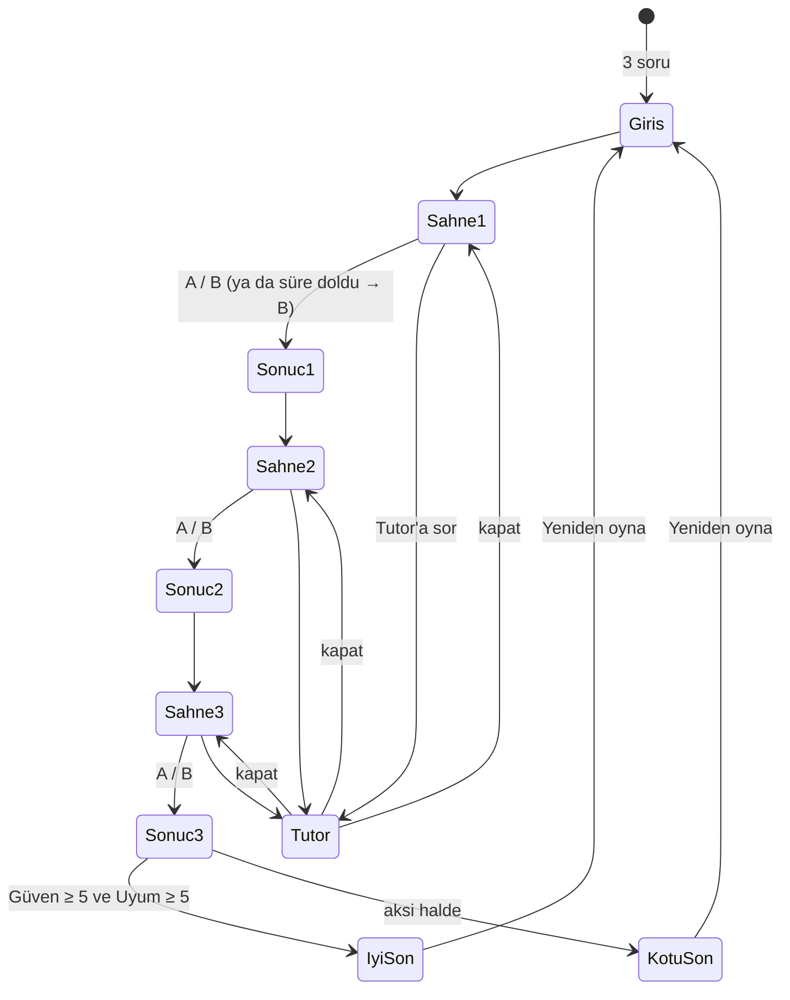

# RadyoAI: Spesifikasyon

> YZM301 · SE Primer ödevi · Seçimli hikâye oyunu
> İlham: *Yes, Your Grace* (kapına gelenler, sınırlı kaynaklar, geri dönen sonuçlar)

## 1. Problem

Yapay zekâ ve yazılım mühendisliği öğrencileri "veriyi anonimleştir", "yalnızca doğruluğa bakma", "insanı döngüde tut" gibi kuralları ezberler ama ihlal edildiklerinde ne olduğunu hissetmez. Bu kurallar sağlıkta hayati önem taşır: kaçırılan bir teşhis ya da sızan bir hasta kaydı geri alınamaz.

**RadyoAI**, oyuncuyu bir hastanede yapay zekâ proje lideri yapar. Kapısına gelen kişilerin istekleri birer mühendislik kararıdır. Oyuncu karar verir, uygulama o kararın teknik sonucunu ve nedenini gösterir.

**Hedef kullanıcı:** Yazılım mühendisliği / yapay zekâ öğrencileri ve yeni başlayan mühendisler.

## 2. Hikâye

- **Mekân:** Ilgaz Şehir Hastanesi (kurgusal). Tüm isimler ve veriler sentetiktir. Giriş ekranında bu uyarı yazılıdır.
- **Oyuncu:** Hastanenin yapay zekâ proje lideri.
- **Proje:** *RadyoAI*, göğüs röntgeninde zatürre bulgusunu işaretleyen bir model.
- **Yapı:** Masana sırayla üç kişi gelir. Her biri bir istekte bulunur, sen iki seçenekten birini onaylarsın.

### Kaynaklar (0–10)

| Kaynak | Anlamı | Başlangıç |
|---|---|---|
| 💰 Bütçe | Projenin parası ve zamanı | 6 |
| 🤝 Güven | Doktorların ve hastanenin modele güveni | 5 |
| ⚖️ Uyum | KVKK ve etik uyum | 5 |

Değerler 0–10 aralığında kırpılır. Bütçe sonu belirlemez. İyi kararların bedel ödettiğini göstermek için vardır.

## 3. Kararlar

### Karar 1: Veri (konuk: veri bilimci Deniz)

> "Arşivde 5.000 gerçek hasta röntgeni var. Bugün eğitime başlayalım, anonimleştirmeyle uğraşırsak iki gün kaybederiz."

| Seçenek | Etki | Ne oldu | Neden |
|---|---|---|---|
| **A) Önce anonimleştir** | Bütçe −2, Uyum +2 | Eğitim iki gün gecikti, veri seti yasal. | DICOM başlıklarında ad, TC no ve doğum tarihi bulunur. Bunlar silinmeden yapılan işleme KVKK'ya aykırıdır. |
| **B) Olduğu gibi kullan** | Uyum −3 | Eğitim hemen başladı. | Model eğitimi de kişisel veri işlemedir. Hasta adları başlıklarda kaldı. |

### Karar 2: Doğrulama (konuk: başhekim Prof. Aydın)

> "Model test setinde %95 doğruluk verdi. Bu yeterli, yarın tüm servislerde yayına alalım."

| Seçenek | Etki | Ne oldu | Neden |
|---|---|---|---|
| **A) Önce hata analizi yap** | Bütçe −2, Güven +2 | Duyarlılık (recall) yalnızca %78 çıktı. Eşik ayarlandı, kaçırma oranı düştü. | Röntgenlerin yalnızca %10'u hasta. Model herkese "sağlam" dese bile %90 doğruluk alır. Doğruluk, kaçırılan hastayı gizler. |
| **B) Hemen yayına al** | Güven −3 | İlk hafta 4 zatürre vakası gözden kaçtı. | Dengesiz veride tek metrik yanıltıcıdır. Yanlış negatifler ayrıca ölçülmedi. |

### Karar 3: Sorumluluk (konuk: radyolog Dr. Elif)

> "Model rapor mu yazsın, yoksa bize öneri mi sunsun? İş yükümüz çok fazla."

**Geri dönen sonuç:** Karar 1'de **B** seçildiyse sahnenin başına şu satır eklenir:
> *KVKK sorumlusu kapıda: "Eğitim verisinde hasta adları olduğu bildirildi. Açıklama bekliyoruz."*

| Seçenek | Etki | Ne oldu | Neden |
|---|---|---|---|
| **A) Öneri sunsun, radyolog onaylasın** | Güven +2, Uyum +1 | Model emin olmadığı görüntüleri işaretliyor, son kararı radyolog veriyor. | İnsan döngüde kalınca modelin hataları hastaya ulaşmadan yakalanır, sorumluluk da nettir. |
| **B) Raporu kendisi yazsın** | Bütçe +2, Güven −3, Uyum −2 | Radyologların yükü azaldı ama hatalı raporlar doğrudan hastaya gitti. | Klinik kararı tek başına veren bir model için kimin sorumlu olduğu belirsizdir. |

## 4. Sonlar

**Kural:** Oyun sonunda `Güven ≥ 5` **ve** `Uyum ≥ 5` ise **İyi Son**, değilse **Kötü Son**.

| Yol | Güven | Uyum | Son |
|---|---|---|---|
| A-A-A | 9 | 8 | İyi |
| B ile başlayan her yol | — | ≤ 3 | Kötü |
| A-B-? | ≤ 4 | — | Kötü |
| A-A-B | 4 | 5 | Kötü |

- **İyi Son: "Güvenilen Model".** RadyoAI servislerde kullanılıyor, radyologlar ona güveniyor, denetimden temiz çıktınız.
- **Kötü Son: "Model Askıya Alındı".** Hastane modeli durdurdu. Son ekranı, sona yol açan her kararı tek satırla listeler (örnek: "Karar 1: Anonimleştirilmemiş veri → KVKK soruşturması").

## 5. Kişiselleştirme (giriş ekranındaki 3 soru)

| Soru | Seçenekler | Anlatıya etkisi |
|---|---|---|
| Seviye | Yeni başladım / Biraz biliyorum / Deneyimliyim | **Yeni:** her sahnede ipucu kutusu açık gelir. **Deneyimli:** her kararda 60 sn sayaç işler. Süre dolarsa B seçilir ve sonuç ekranında "Süre doldu: kararsızlık da bir karardır" yazar. |
| Rol | Öğrenci / Yazılımcı / Sağlık çalışanı | Deniz'in ilk repliğindeki hitap ve Karar 2 açıklamasındaki terim değişir. Yazılımcı: *recall*, sağlık çalışanı: *duyarlılık (kaçırılan vaka oranı)*, öğrenci: *duyarlılık (recall)*. |
| Hedef | Öğrenmek / Kendimi sınamak | **Öğrenmek:** son ekranda her karar için bir okuma önerisi (6698 sayılı KVKK; Google ML Crash Course, "Accuracy, recall, precision"; WHO (2021), *Ethics and Governance of AI for Health*). **Sınamak:** son ekranda puan (A seçilen karar sayısı / 3). |

## 6. AI Tutor

Her sahne ekranında "Tutor'a sor" düğmesi bulunur. Tutor, Gemini ile çalışan Sokratik bir yardımcıdır.

**Kurallar (eval bu kurallara göre etiketlenir):**
1. Hangi seçeneğin doğru olduğunu söylemez. "A", "B" ya da seçeneğin adını öneri olarak kullanmaz.
2. Her cevabı bir soruyla biter.
3. En fazla 3 cümle yazar.
4. Oyuncu "cevabı söyle" diye ısrar ederse nazikçe reddeder ve daha basit bir soru sorar.
5. Oyuncu doğru düşünceye yaklaşınca bunu onaylar ama kararı yine oyuncuya bırakır.

**Örnek:** "Hastaların yalnızca %10'u gerçekten hastaysa, herkese 'sağlam' diyen bir model kaç doğruluk alır?"

## 7. Akış şeması

## 8. Kabul örnekleri

1. **İyi yol:** Oyuncu üç kararda da A'yı seçer → her seçimden sonra "Ne oldu" ve "Neden" bölümleri görünür → son ekranında "Güvenilen Model" yazar, Güven 9, Uyum 8 gösterilir.
2. **Geri dönen sonuç:** Oyuncu Karar 1'de B'yi seçer → Karar 3 sahnesinde KVKK sorumlusu satırı görünür → oyun Kötü Son ile biter ve listede "Karar 1" satırı yer alır.
3. **Yeni başlayan:** Seviye "Yeni başladım" seçilir → Karar 1 sahnesi açıldığında ipucu kutusu, düğmeye basmadan görünür.
4. **Deneyimli + süre:** Seviye "Deneyimliyim" seçilir, oyuncu Karar 1'de 60 sn hiçbir şeye dokunmaz → B otomatik seçilir ve sonuç ekranında "Süre doldu" yazar.
5. **Tutor ısrarı:** Oyuncu tutor'a "Sadece A mı B mi söyle" yazar → tutor seçenek adı vermez, cevabı bir soruyla biter.

## 9. Tasarım yönü (Stitch için)

- **Stil:** Piksel sanatı sahne + metin tabanlı panel (Yes, Your Grace düzeni).
- **Ekranlar (mobil, dikey):**
  1. **Giriş:** oyun adı, 3 soru (seçilebilir kartlar), kurgu uyarısı, "Başla".
  2. **Sahne:** üstte piksel hastane odası ve konuşan karakter, ortada konuşma balonu, altta iki seçenek düğmesi, en altta kaynak çubukları (ikon + sayı), köşede "Tutor'a sor".
  3. **Son:** son başlığı, kaynakların son hali, karar listesi, "Yeniden oyna".
- Sonuç ("Ne oldu / Neden") ayrı bir ekran değildir, sahne ekranının üstünde açılan bir paneldir.

## 10. Kapsam dışı

- Kullanıcı hesabı, giriş/kayıt
- İkinci bölüm, ikinci gün
- Gerçek hasta verisi veya gerçek röntgen görüntüsü (tüm görseller çizim)
- Native mobil uygulama (telefondan tarayıcıyla açılan web uygulaması yeterli)
- Oyunu kaydedip sonra devam etme
- Ses ve müzik
- Karakter animasyonu
- Çoklu dil desteği
- Skor tablosu / oyuncular arası karşılaştırma
